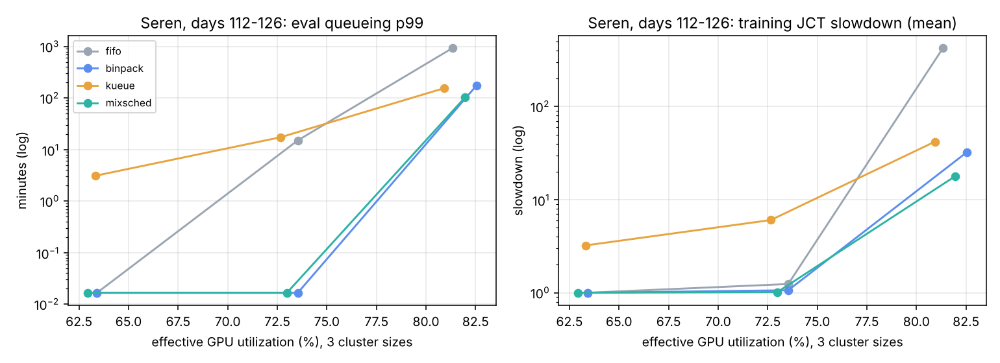
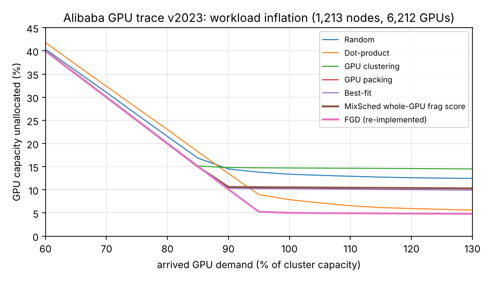

# MixSched

GPU scheduling for mixed training, evaluation and inference work, in two
planes:

- a **trace-driven simulator** that replays the public Acme job logs from
  Shanghai AI Lab's LLM clusters (Hu et al., NSDI '24) under four policies
  (strict FIFO, best-effort FIFO with bin packing, a Kueue-style model, and
  MixSched), plus FGD's fragmentation experiment on the Alibaba GPU trace
  v2023;
- a **Kubernetes scheduler-framework plugin** compiled into kube-scheduler
  v1.34.2 (eval-first QueueSort, fragmentation-aware Score, PreFilter +
  Permit gang scheduling), benchmarked on a local control plane with up to
  5,000 KWOK fake GPU nodes.

MixSched combines eval-first ordering, fragmentation-aware placement, eval
GPU sharing and adaptive batching, an inference pool that lends idle GPUs
only to evaluations that will finish before forecast demand returns, and
checkpoint-aware reclaim. Every mechanism can be switched off for ablation.

**Real job traces, simulated clusters.** Job sizes, types, submit times and
runtimes come from Acme; placement, queueing, sharing and preemption are
simulated, and the inference fleet is synthetic (Acme has none). KWOK nodes
are simulated nodes: pods bind but never run. Model and limits:
[`docs/DESIGN.md`](docs/DESIGN.md). Tables:
[`results/SUMMARY.md`](results/SUMMARY.md).

## Results

### Trace replay: Acme (simulated)

Seren, days 112-126 (the most evaluation-heavy two weeks: 164,525 GPU
jobs). The real cluster had 286 nodes; shrinking it to 240 and 200 raises
the load. At 286 and 240 nodes MixSched and binpack keep every queue near
zero (strict FIFO's eval p99 already reaches 15 minutes at 240), while the
Kueue-style policy fragments nodes (0.56 to 0.68 of free GPUs stranded) and
makes training gangs wait. At 200 nodes (about 82%
effective utilization):

| | eval queue p99 | training queue p99 | training JCT slowdown | fragmentation | GPU-h lost to reclaim | inference SLO |
|---|---|---|---|---|---|---|
| strict FIFO | 15.6 h | 15.8 h | 425 | 0.52 | 0 | 100% |
| binpack | 2.9 h | 3.0 h | 32.4 | 0.39 | 0 | 100% |
| Kueue-style | 2.6 h | 2.8 h | 42.0 | 0.75 | 280 | 99.65% |
| **MixSched** | **1.7 h** | **1.6 h** | **17.9** | **0.24** | 11 | 100% |

On the second window (Seren days 84-98, 200 nodes) MixSched's eval p99 is
1.3 h against 2.6 h (binpack) and 6.0 h (Kueue-style), and its mean training
slowdown 6.2 against 9.7 and 12.4. Effective utilization is within about one
point of the other policies: the work is fixed by the trace, so the gains are
in who waits, not in how much gets done.



(Zero delays are drawn at 1 s on the log scale.)

**What the ablations say** (200 nodes, one mechanism changed at a time, both
windows):

- consistent on both windows: **fragmentation-aware placement** (without it,
  fragmentation rises 3-5x and training slowdown roughly doubles) and **lease-aware
  lending** (without it, reclaim preempts 15 to 7,255 borrowers and wastes
  1,191 to 2,171 GPU-hours, against 3 to 11);
- **EASY reservation** for blocked gangs lengthened training queues on both
  windows, so it is off by default;
- **predictive reclaim** is what keeps the inference SLO at 100% (99.6%
  without it) on both windows;
- eval-first ordering, sharing and batching help on one window and are
  neutral or slightly negative on the other. The cluster
  dynamics are sensitive at this load (a small change reorders thousands of
  jobs), so two windows are not enough to rank them.

The Kalos window (days 46-60, 95% of GPU time in pretraining gangs) produced
no queueing at any size tested; all policies tie there, which shows MixSched
costs nothing when the cluster is not contended.

### Fractional GPUs: FGD on the Alibaba GPU trace v2023 (simulated)

FGD's workload-inflation experiment (Weng et al., ATC '23) re-run on the
public `openb` trace: tasks sampled with replacement (shared-GPU, whole-GPU
and CPU-only) and placed one at a time on the 1,213 GPU nodes (6,212 GPUs),
no departures, 10 sampling seeds. Share of GPU capacity left unallocated:

| policy | at 90% of capacity requested | at 100% | at 120% |
|---|---|---|---|
| random | 14.5% | 13.4% | 12.6% |
| GPU clustering | 14.8% | 14.7% | 14.6% |
| GPU packing | 10.6% | 10.5% | 10.3% |
| best-fit | 10.3% | 10.2% | 10.0% |
| MixSched's whole-GPU fragmentation score | 10.6% | 10.5% | 10.4% |
| dot-product | 13.5% | 7.9% | 6.0% |
| **FGD (re-implemented)** | **10.1%** | **5.0%** | **4.9%** |



FGD leaves 36% less capacity unallocated than the best baseline at 100%
requested (5.0% vs 7.9% for dot-product), in the direction and range of the
paper's "up to 49%". **MixSched's own score is no better than plain packing
here** (10.5% both): it models whole GPUs, so it cannot see how a shared
task's fraction of a GPU strands the rest of that GPU. On Acme, which has
only whole-GPU jobs, that model is enough; for fractional work FGD's
per-GPU fragment measure is what is needed.

### Real control plane: kube-scheduler on KWOK nodes (measured; nodes simulated)

kube-apiserver, kube-scheduler v1.34.2 (with the plugin compiled in), etcd
and KWOK, all built from source and sharing one 2-vCPU VM with the benchmark
client. Each run fills the cluster to 90% of its GPUs with one job mix (55%
single-GPU evals, small training jobs, 1-8-node gangs of 8-GPU pods). Three
seeds at 1,000 nodes, one at 5,000 (the remaining 5,000-node seeds were not
run):

| nodes | scheduler | pods/s | attempt p50 / p99 | Score p99 | GPU allocation | whole 8-GPU nodes left | unscheduled pods |
|---|---|---|---|---|---|---|---|
| 1,000 | default (spread) | 168 | 29 / 524 ms | 8.4 ms | 55.4% | 0 | 347 |
| 1,000 | GPU bin packing | 235 | 55 / 689 ms | 7.8 ms | 90.1% | 99 | 0 |
| 1,000 | **MixSched** | **252** | 71 / 706 ms | 6.1 ms | 90.1% | 99 | 0 |
| 5,000 | default (spread) | 70 | 44 / 510 ms | 11.5 ms | 57.1% | 0 | 1,645 |
| 5,000 | GPU bin packing | 121 | 56 / 810 ms | 9.8 ms | 84.9% | 0 | 255 |
| 5,000 | **MixSched** | **160** | 92 / 1,023 ms | 9.7 ms | 90.0% | 13 | 0 |

- **Spreading strands gangs.** The default scheduler leaves no whole node
  free, so 8-GPU gang members cannot fit and the cluster stops at 55-57% GPU
  allocation. MixSched placed every pod at both sizes, including all gangs.
- **Attempt latency is higher for MixSched by design**: kube-scheduler records
  it after the binding cycle, so it includes a gang member's Permit wait for
  the rest of its gang. The plugin's own cost is small (Score p99 6-10 ms for
  all score plugins of the profile).
- **Fidelity.** On the same job sequence, the simulator's placement matches
  the real scheduler exactly at 1,000 nodes (fragmentation 0.004 and 99 whole
  nodes for both packing policies, 1.000 and 0 for spreading). At 5,000 nodes
  it does not: the simulator keeps 500 whole nodes, kube-scheduler 0
  (binpack) and 13 (MixSched). kube-scheduler scores only a sample of feasible
  nodes, 50% minus 1% per 125 nodes (42% of 1,000, 10% of 5,000), from a
  rotating start, so any scorer sees a 500-node window and packing degrades
  into spreading across windows. None of the profiles set
  `percentageOfNodesToScore`; setting it to 100 is the obvious next run and was
  not done.

## Quick start

```bash
git clone --depth 1 https://github.com/InternLM/AcmeTrace /tmp/AcmeTrace
cp /tmp/AcmeTrace/data/job_trace/trace_*.csv data/
go build -o bin/mixsched ./cmd/mixsched && go test ./...

./bin/mixsched -trace data/trace_seren.csv -from-day 112 -days 14 -nodes 200 \
    -policies fifo,binpack,kueue,mixsched,mixsched-nofrag,mixsched-nolease
./bin/mixsched fgd -seeds 10 -out results/fgd.jsonl     # Alibaba v2023 (data/alibaba is included)
bench/run_all.sh      # every simulator result in results/ (about 40 minutes)

bench/k8s/build.sh    # kube-apiserver, kubectl, kube-scheduler + plugin, driver (Kubernetes v1.34.2 checkout)
bench/k8s/fetch.sh    # etcd 3.6.4 and KWOK 0.7.0 from source
bench/k8s/run.sh      # KWOK benchmark and the simulator side of the fidelity check (about 40 minutes)
python3 bench/plot.py results/runs.jsonl results
```

## Layout

```
trace/          Acme CSV loader (types, gangs, runtimes, windows), Alibaba v2023 loader
sim/            cluster, events, placement, sharing, batching, lending, reclaim, metrics; FGD inflation; static fill; tests
cmd/mixsched/   run policies in parallel, fgd, fill; JSON lines out
k8s/scheduler/  kube-scheduler with the MixSched plugin (QueueSort, PreFilter, Score, Permit) and its unit tests
k8s/config/     scheduler profiles: default, binpack, mixsched
k8s/bench/      KWOK benchmark driver (nodes, job mix, fill, metrics scrape)
bench/          run_all.sh, plot.py, k8s/ (build, fetch, cluster, run)
results/        SUMMARY.md, figures, runs.jsonl, fgd.jsonl, k8s.jsonl, fill-*.jsonl
docs/DESIGN.md  model, policies, the Kubernetes port, metrics, validity threats, interview notes
```

## What is not here

- **Kueue.** No ClusterQueues, cohorts or workload slices were configured.
  The plugin covers what belongs in kube-scheduler (ordering, placement,
  gangs); lending inference GPUs, leases and reclaim exist only in the
  simulator, where they would be Kueue admission and preemption policy.
- **Running pods.** KWOK pods are bound and never run, so the KWOK numbers
  measure the control plane (throughput, latency, placement), not job
  completion, preemption or GPU use.
- **Departures in the fidelity check**: both sides fill an empty cluster; the
  dynamic effects measured in the simulator (queueing, reclaim) are not
  replayed on Kubernetes.
- **5,000-node seeds 2 and 3, and a run with `percentageOfNodesToScore: 100`**:
  stopped to finish on time; the 5,000-node rows are one seed.
- **MIG**: sharing is modelled as MPS (two evals per GPU with a slowdown).
- **Upstream**: nothing was contributed to Kueue or scheduler-plugins.

## Resume bullets (trace replay and KWOK; say "simulated")

- Designed MixSched, a GPU scheduling layer for mixed training, evaluation
  and inference (eval-first ordering, fragmentation-aware placement, eval GPU
  sharing and batching, lease-aware lending of idle inference GPUs,
  checkpoint-aware reclaim), evaluated by replaying about 222k jobs of the public
  Acme LLM-cluster traces in a Go discrete-event simulator.
- At about 82% effective utilization on Seren, cut simulated p99 eval
  queueing from 2.6 h to 1.7 h and mean training JCT slowdown from 42 to 18
  against a Kueue-style baseline, with node fragmentation down from 0.75 to
  0.24 and 100% inference SLO; ablations showed lease-aware lending alone
  avoided 1.2-2.2k GPU-hours of preempted work per two weeks.
- Built the placement half as a kube-scheduler v1.34.2 framework plugin
  (eval-first QueueSort, fragmentation-aware Score, PreFilter + Permit gangs)
  and benchmarked it on a from-source control plane with 1,000 and 5,000
  KWOK GPU nodes: 252 and 160 pods/s with every gang placed, against 168 and
  70 pods/s for the default scheduler, which stranded 347 and 1,645 gang pods;
  found that kube-scheduler's node sampling (10% of 5,000 nodes) breaks the
  simulator's placement fidelity at 5,000 nodes while it matched exactly at
  1,000.
- Re-implemented FGD (ATC '23) on the Alibaba GPU trace v2023: 36% less
  unallocated GPU capacity than the best baseline at full demand (5.0% vs
  7.9%), and showed MixSched's whole-GPU fragmentation score was no better
  than packing on fractional-GPU work.
